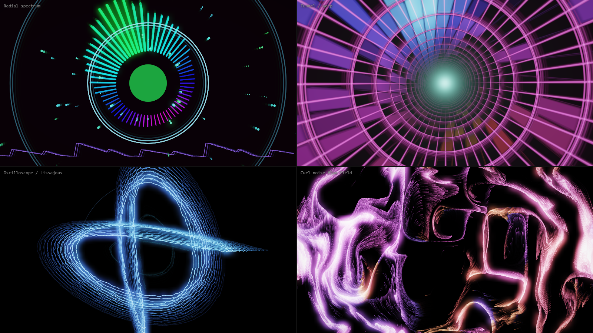

# Einklang
Deterministic audio visualizer (German *Einklang*: "unison"). Every screen shows the same scene state on the same tick. See [SPEC.md](SPEC.md) for the full design and [tickets/](tickets) for the roadmap.

## Status
TypeScript + Vite, **WebGPU only** for now (the WebGL2/naga fallback in the spec is deferred). Done so far:

- Shared integer core (`src/core`): sine LUT, hash, the demo track, four scenes as pure `state(tick, features)` functions.
- WebGPU renderer (`src/web`): display-list SDF renderer, HDR post chain (feedback trails, bloom, ACES), and the four v1 scenes: radial spectrum (bit-identical port of the prototype), tunnel/warp, oscilloscope/Lissajous, and a fixed-point curl-noise flow field (131k particles).
- The flow field runs as i32 compute. The page checks the GPU result against the CPU reference (`gpu≡cpu ✓` in the HUD) every 2 s.
- Server (TS, no runtime dependencies), split into `ws.ts` (WebSocket framing), `auth.ts` (token and bind addresses) and `room.ts` (protocol):
  - **Room token (#2)**: it listens only on localhost and tailnet addresses. Every HTTP and WS request needs the token.
  - **Protocol v2 (#3)**: the server owns the mode, scene schedule, presets, beat grid and host views. Inputs become tick-stamped events, applied `INPUT_DELAY` (6) ticks after the server receives them. Joiners get the event log and the live feature ring (2 reseed periods). If an event arrives late, the flow sim rewinds and replays it.
  - **Presets and views (#9)**: scene switches land on the next beat or bar. Each host has a view (normal, mirror, flip, rotate 180, zoom, kaleido): its default comes from `?view=N`, and any host can override it from the hosts list.
- Tests: pinned determinism hashes, order-independence, flow-sim independence, hit events, MIDI (sanitizing, clock master election and beat stamping, CC persistence, note/beat/CC features), and server integration (auth, events, quantized switching, views, file mode). CI runs typecheck, tests and build. `npm run e2e` runs two real WebGPU browser hosts and checks they produce identical hashes at the same ticks, including while a third socket plays MIDI clock, notes and a CC.

Not done yet:
- Without a MIDI clock the beat grid is a fixed 28 ticks per beat, until beat tracking (#14) lands. The flow sim's reseed period stays on that fixed grid.
- There is no display-rate interpolation yet (#12).
- MIDI CCs use a fixed map (no MIDI learn), and MIDI start/stop doesn't start or stop file playback. Drift mode (pads) and WebHID extras aren't implemented.

## Run

    npm install

- **Gallery** (no server, synthetic demo track): `npm run dev`, then open `http://localhost:5173/gallery.html`. Keys `1`–`4` switch scenes, `g` toggles the grid and `h` hides the UI. URL params: `scene=`, `grid=1`, `start=<s>`, `stop=<s>`, `hud=0`.
- **Synced app, prod**: `npm run build && npm run server`. The server prints a join URL ending in `?t=<token>` for localhost and each tailnet address; open it on each device. The token is generated on first run and saved to `.einklang-token`; set `EINKLANG_TOKEN` to choose your own. Set `BIND=0.0.0.0` to listen on the LAN as well.
- **Synced app, dev**: run `npm run server` and `npm run dev` together, then open `http://localhost:5173/?t=<token>`. Vite proxies `/ws` and `/track` to the server.
- **Mockups**: `npm run mockups` renders `docs/mockups/*.png` using real WebGPU in headless Chrome.
- **Checks**: `npm run typecheck`, `npm test`, and `npm run build && npm run e2e` (needs Chrome with WebGPU).

Requires Node 22.6+ and a Chrome with WebGPU.

To verify sync, open the debug panel (`d`) and check that the `hash` matches across hosts.

- **File mode**: any host loads tracks with **files** (one or more) or **folder** (every audio file in it, in natural path order). Formats are whatever Chrome decodes: mp3, wav, flac, ogg/opus, m4a/aac, webm. Each track is decoded and analyzed (in a worker) on that host, the features go to every host, and playback starts 2.5 s later. The next track is prepared while the current one plays, and the list auto-advances and wraps. Tick "audio here" on hosts that should play sound.
- **Transport bar** (bottom, on every host): prev (restarts the track if past 3 s), play/pause (`p`), next, track name and position, and a progress bar you click or drag to seek (`←`/`→` seek ±10 s). Pause freezes the picture on every host. Prev/next from any host are relayed to the host that holds the files; if that host leaves, the list goes with it.
- **Live mode**: the leader captures from a mic or line-in and streams features. Everyone renders 100 ms behind to absorb network jitter. Browsers only allow audio capture on localhost or https, so run the leader on the server machine at `http://localhost:8080`, or use `tailscale serve 8080` to get https.
- **offset ms**: a per-host trim for display latency (TV vs. panel). It's saved per device.
- **Scene, quantize, hit, hosts**:
  - `[` and `]`, or the arrows, step through the presets; the picker jumps straight to one. Switches land on the next beat, bar, or immediately (the "on" selector).
  - Space sends a manual hit. `h` hides all the UI.
  - **hosts** lists connected hosts and lets you override each one's view. `?name=` names a host.
- **MIDI**: press **midi** on any Chrome host that has a MIDI device (the choice is remembered). Enable it on only one host per device, or every note arrives twice.
  - **Clock**: the first host to send one is the master until it goes silent for 2 s. Its tempo and beat phase set the room's beat grid, so beat and bar quantizing follow the clock. MIDI start makes the next beat a downbeat. In the radial scene the core thumps on every beat.
  - **Notes**: each note-on counts as an onset in every scene. In the radial scene, pitch sets the burst's direction and color, and octave sets its speed.
  - **CCs**: CC 1 (mod wheel) rotates every scene's palette. CC 74, 71 and 10 also reach the scenes as params, but no scene uses them yet. The last value of each CC is kept across track changes and sent to late joiners.
- **Gamepads**: plug any pad into any host (Chrome, standard mapping: DualSense, Xbox, Deck). There is nothing to enable; press a button. Each pad gets a room-wide color, and its own layer: a cursor at its FX center plus the shockwaves it fires. Effects from all pads mix.
  - ✕/A shockwave (repeats while held), ○/B strobe, □/X invert + glitch, △/Y kaleido around the pad's center. Share/View: blackout while held.
  - Left stick: FX center. Right stick: rotation (x) and zoom (y) drift of the trails. L2: trails. R2: bloom.
  - L1/R1: previous/next scene (uses the "on" quantize). D-pad left/right: palette. Up/down: this host's view.
  - L3: hit. R3: freeze toggle (the scene stops; trails and FX keep moving). Options/Menu: tap tempo (sets the beat grid when no MIDI clock is running).
  - Pad state goes out only when it changes, at most once per tick, and is stamped like any event. The FX are a pure function of the event log, so every host draws the same thing.
- **Debug panel**: press `d`, click **debug**, or add `?debug=1`. It shows a frame-time graph with hitches marked in red, fps, p99 and max frame time, recent hitches, and skipped or repeated ticks. It also shows network stats (RTT, clock offset, message and byte rates, live-feature gaps, late events), room state (epoch, scene schedule, grid, hosts) and MIDI status (inputs, local clock, room clock master, CC values).

How it works: each scene's `state(tick, features)` uses integers only. Scenes are stateless with 600 ticks of lookback, so late joiners and dropped frames can't drift. The flow field is the exception: it is a sim, so it reseeds every 8 bars and fast-forwards up to 50 steps per frame. The tick comes from a server clock synced NTP-style (min-RTT sample).
